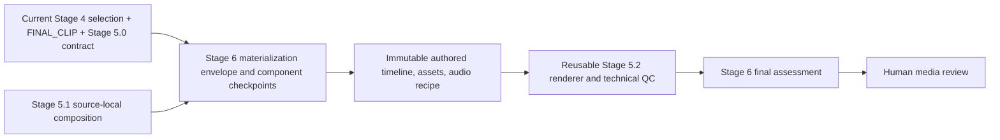

# Stage 6 production architecture — SOL implementation specification

Date: 2026-10-14. Author: SOL, main architect/reviewer. Inspected baseline:
`098cc2c`. This document specifies implementation; it does not claim Stage 6 is
implemented or accepted. V4 implements; SOL reviews; the operator reviews media.

This specification resolves the remaining engineering decisions in the existing
Stage 6 direction. It supersedes contradictory Stage 6 helper implementations
and earlier continuation advice. Frozen Stages 3–5 contracts remain authoritative.
Read the companion [implementation plan](../plans/2026-10-14-stage-6-production.md).

## 1. Outcome, boundaries, and fixed constraints

Produce one genuinely transformed Short from one eligible selected candidate.
The final artifact must fulfill the selected plan's substantive requirements,
preserve its strongest source moment, and carry actual technical/semantic review
evidence. Zero output is valid when the requirements cannot be met.



- Stage 6 owns scripts, narration decisions/execution, retention decisions,
  authored layouts, asset selection, mix recipe, mastering policy, assessment,
  and one bounded repair. Stage 5.2 executes these instructions deterministically.
- `CORE_SOURCE_VALIDATION` remains a diagnostic output, never a required input
  to `TRANSFORMED_SHORT`. Never decode/re-edit an intermediate H.264 render.
- No new PipelineStage, PipelineRun, automatic `_NEXT_STAGE` entry, source
  lifecycle transition, or job platform. Use ProcessingJob/Celery/RenderExecution.
- Preserve upstream transcription/governance fixes, PyAV compatibility pin,
  blank optional language normalization, selectable-window filtering, and UI work.
- No gate reduction, all-candidate loop, source fallback search, publication,
  scheduling, upload, account orchestration, or platform integration.
- Semantic budget: at most 4 reserved raw attempts per generation, at most 2
  strong-tier attempts, including repair and uncertain attempts.
- Narration: at most 3 chunks, at most 60 seconds accepted total, at most 6
  synthesis attempts including repair/uncertain attempts. At most 180 seconds
  final video. One repair opportunity per materialization generation.
- Supporting visuals default OFF, at most one selected asset. Rights-cleared,
  local, muted, and zero substantive-originality credit.
- Final audio: stereo, 48 kHz, -16 LUFS with existing ±1 LU tolerance; final
  encoded true peak at or below -1.5 dBTP. Final audio must be measured.
- `publication_ready` always remains false. Review readiness requires real media.

## 2. Live implementation facts and the integration problem

Reuse the materialization domain models, pure types/validation, source binding,
profile matching, rights manifest, and explainable assessment already present.
Reuse the renderer's CPU encoding, framing, ASS handling, subprocess cancellation,
deadlines, resource admission, artifact identity, QC, fencing, and storage.

The inspected code's six verified gaps are structural:

1. Queue CAS targets each new job, so two sessions can enqueue two scoped jobs.
2. Different jobs' local claim counters are compared as generation ordering.
3. Provider attempts are reserved in memory and persisted after provider work.
4. Resume restores request identities without accepted component content.
5. Failed broker dispatch is committed but never recovered by the next POST.
6. Upstream can become stale during provider work and still receive current output.

Do not patch these with extra numeric comparisons. Implement the ownership and
component protocols below once, then route production through them.

## 3. File responsibilities and interfaces

Existing pure logic stays in `backend/app/materialization/{scripting,timeline,
supporting,narration,acceptance,fingerprints,types,inputs,profiles,policy}.py`.
Split the current large service only along these directly required seams:

| File | Responsibility |
| --- | --- |
| `materialization/service.py` | Assemble/revalidate authoritative inputs; public read facade. |
| `materialization/repository.py` (new) | Short fenced DB transactions, envelope ownership, ledger/checkpoint persistence. |
| `materialization/components.py` (new) | Execute/replay SCRIPT, NARRATION, SUPPORTING, TIMELINE components using the repository. |
| `materialization/queue.py` | Envelope-first enqueue, active-job reuse, dispatch recovery, finalizer enqueue. |
| `materialization/executor.py` | Claim job/envelope, drive components or finalization, heartbeat/cancel/release. |
| `materialization/rendering.py` (new) | Map persisted authored timeline into typed renderer payload; no FFmpeg. |
| `materialization/overlays.py` (new) | Deterministic authored ASS/layout and readability evidence. |
| `materialization/gemini.py` (new) | Single-request writing/critique transports and strict structured responses. |
| `materialization/tts_gemini.py` (new) | Provider-neutral narration implementation, exact audio/container identity. |
| `materialization/finalization.py` (new) | Exact render/materialization binding, final assessment, bounded repair allocation. |
| `materialization/acceptance_export.py` (new) | Read-only assembly/export of genuine acceptance evidence. |
| `render/execution/authored.py` (new) | Typed authored payload, structural validation, video graph compilation. |
| `render/execution/audio.py` (new) | Deterministic mix preparation, measurement/mastering execution, final loudness measurement. |

Use frozen dataclasses for value objects and Pydantic strict schemas at persisted
JSON/provider/API boundaries. `extra='forbid'`; reject booleans as numeric IDs,
non-finite values, duplicate IDs, malformed hashes, unknown operation kinds,
unmanaged paths, and mismatched references. Never silently coerce invalid input.

The following are specified interfaces, not claims that these symbols exist now:

```python
@dataclass(frozen=True)
class MaterializationOwner:
    materialization_id: UUID
    job_id: UUID
    job_claim_version: int
    materialization_claim_version: int

# repository.py
get_or_create_envelope(session, inputs, request_identity) -> ClipMaterialization
claim_materialization(session, materialization_id, job_id) -> MaterializationOwner | None
load_component(session, materialization_id, component, dependency_fp) -> dict | None
reserve_attempt(session, owner, component, dependency_fp, kind, tier) -> dict
save_attempt_result(session, owner, attempt_id, response, checkpoint) -> bool
save_local_component(session, owner, component, dependency_fp, result) -> bool
commit_prepared(session, owner, prepared) -> bool

# components.py
prepare_materialization(context, providers) -> PreparedMaterialization

# rendering.py
build_transformed_render_spec(session, candidate, *, materialization_id,
    expected_output_fingerprint, delivery_profile_key, settings, storage) -> RenderSpec

# finalization.py
finalize_materialization(session, owner, *, settings, storage) -> FinalizationResult
```

`PreparedMaterialization` contains the existing accepted script/claims/slots,
actual narration references, selected supporting references, authored timeline,
audio recipe, pre-render assessment, component fingerprints, and upstream
snapshot. `FinalizationResult` is one of COMPLETE, REPAIR_QUEUED, DEFERRED,
SUPERSEDED, CANCELLED, with reason codes. It never asserts publication permission.

## 4. Envelope, ownership, and locking

### 4.1 One envelope per input generation

Reuse `clip_materializations` with its existing unique candidate/profile/input
constraint and one-current-row partial index. Create the row BEFORE providers.
Persist request options and upstream identities when it is queued. Fill accepted
component output incrementally; an output fingerprint is absent/empty until a
complete executable recipe exists.

`is_current` means the authoritative requested generation in that scope. It does
not mean completed, accepted, cached, or publishable. Old generations are history.
The public read facade also computes live effectiveness; it does not trust this
flag alone. Reads do not repair, dispatch, or mutate state.

No new database tables are required. Reuse `claim_version`, `active_job_id`,
`request_payload`, `component_checkpoints`, `call_ledger`, `repair_count`, and FKs.
Use a migration only if a proven constraint/type incompatibility requires one.
Do not delete historical materializations to make a migration/downgrade pass.
For migration 0024 downgrade, map DEFERRED_EVIDENCE to the older FAILED outcome,
retain DEFERRED_EVIDENCE in reason_codes/history, set lifecycle BLOCKED and all
review/cache/publication flags false. Preserve rows and foreign-key relationships.

### 4.2 Two local ownership tokens, never a global ordering

- ProcessingJob.claim_version advances whenever THAT job is claimed/reclaimed.
- ClipMaterialization.claim_version advances whenever THAT envelope is claimed.
- Both counters are local. Never compare counters across jobs or envelopes.
- An owner is valid only when all four fields in MaterializationOwner match,
  the job is RUNNING, the envelope's active_job_id equals the job ID, the job's
  materialization_id equals the envelope ID, and the envelope is current/effective.
- The job must have kind MATERIALIZATION and the correct source/refinement scope.

Every authoritative worker update uses these predicates in SQL, with rowcount
checked. No optional owner bypass in production. Pure fixture construction may
use separate test helpers; do not expose an unfenced production persistence path.

### 4.3 Locks and short transactions

Use PostgreSQL row locks, not another lease/job system. Queue requests first lock
the candidate; every Stage 6 queue path follows that rule, including different
profiles. The one-candidate scope makes this deliberately conservative.

For authority-changing work use the frozen renderer publication lock order as
the spine: candidate → bound contract → selected plan → FINAL_CLIP refinement →
visual composition. Extend consistently with plan-set/selection/profile rows
needed for mutable dependencies, then materialization → render execution → jobs.
Order multiple jobs by UUID. Never acquire candidate/upstream locks after an
envelope/job lock in the same transaction. Heartbeats lock only their job.

After acquiring locks, use fresh scalar/select queries or populate_existing;
do not accept identity-map state as a currentness check. Re-run the frozen read
helpers with the actual settings/config, compare exact identities/fingerprints,
and verify required artifact hashes outside long critical sections followed by
stat/identity checks at publication. Follow existing media identity conventions.

No locks are held during network calls, Whisper, FFmpeg, audio measurement, or
QC. End any earlier read transaction before the next short mutation transaction.

### 4.4 Queue algorithm

```text
BEGIN
  lock candidate and refresh authoritative prerequisite state
  assemble inputs; compute exact generation request fingerprint
  find/create that envelope; demote previous current row only for valid new inputs
  if an owned QUEUED/RUNNING job already exists: return its identity
  if final valid cache exists and !force: return cached
  if AWAITING_RENDER: decide render dispatch recovery or finalization, below
  otherwise create MATERIALIZATION job with envelope/refinement/source FKs
  CAS envelope.active_job_id from NULL to that job; loser rolls back its new job
  persist complete request_payload; commit
dispatch the committed job
on broker failure: persist MATERIALIZATION_DISPATCH_FAILED under same job/envelope
```

The next POST/resume retries dispatch of the SAME pending job and original request.
Duplicate broker delivery is safe because worker claim is atomic. A crash after
broker success but before clearing the marker may redispatch; that is harmless.
`force` is a cache bypass/recovery request, not permission to erase checkpoints,
repair usage, request history, or budgets. Changed content/config creates a new
input identity; unchanged work resumes the existing generation.

### 4.5 Worker and cancellation

Worker atomically claims the job and increments its local claim, then claims the
envelope under the scope lock and increments the envelope claim. Reclaim only
after stale heartbeat under existing conventions. Every expensive phase checks
fresh job status/ownership before and after work. Heartbeat loss is sticky.

Cancellation is candidate/materialization scoped. In one short transaction mark
the active MATERIALIZATION job CANCELLED and the envelope CANCELLED; if its
TRANSFORMED_SHORT render is active, cancel it using existing render cancellation
conventions. Do not cancel unrelated core validation/history work. The finalizer
must not revive cancelled output. Explicit resume can create a new job for the
same generation and reuse valid accepted checkpoints; it does not reset budgets.

Finish job and corresponding envelope transition in the same transaction.
Preserve checkpoints on cancellation/failure. Release provider/model resources on
all exits, including cache hit/duplicate/cancel. Clean only this worker's owned
temporary files; do not sweep other workers' temporary storage with age zero.

## 5. Durable attempts and actual checkpoint recovery

### 5.1 Persisted JSON formats

Use existing JSON columns; validate them on both read and write:

```json
{
  "component_checkpoints": {
    "SCRIPT": {
      "dependency_fingerprint": "sha256",
      "status": "ACCEPTED",
      "writing": {"attempt_id": "uuid", "response": {}},
      "critique": {"attempt_id": "uuid", "response": {}},
      "result": {"authored_blocks": [], "claim_ledger": [], "findings": []},
      "result_fingerprint": "sha256"
    },
    "NARRATION": {
      "dependency_fingerprint": "sha256",
      "chunks": {
        "chunk-1": {
          "synthesis": {"status": "ACCEPTED", "attempt_id": "uuid", "asset": {}},
          "validation": {"status": "ACCEPTED", "asr_identity": {}, "findings": []}
        }
      }
    }
  },
  "call_ledger": {
    "version": "stage6-attempts-v2",
    "entries": [{
      "attempt_id": "uuid",
      "component": "SCRIPT.WRITE",
      "dependency_fingerprint": "sha256",
      "phase": "INITIAL",
      "ordinal": 1,
      "kind": "semantic",
      "tier": "ROUTINE",
      "status": "RESERVED",
      "provider_identity": {},
      "response_fingerprint": null
    }]
  }
}
```

Checkpoint statuses: PENDING, ACCEPTED, DEFERRED, REJECTED. Attempt statuses:
RESERVED, RESPONDED, FAILED_KNOWN, UNCERTAIN. Timestamps are audit data only.
Use new dict assignments for SQLAlchemy JSON mutation tracking.

The schema examples show shapes, not permission to store empty required results
as accepted. SCRIPT also stores accepted intermediate writing before critique;
accepted synthesis is stored before local ASR. Resume those partial phases.

### 5.2 Request gateway algorithm

1. Load an exact dependency-matching accepted response/checkpoint. Validate its
   schema/assets and return it with zero network calls.
2. Check owner/cancellation and remaining generation budgets locally.
3. Request the shared Gemini HIGH admission permit, outside an open DB transaction.
   Denied admission creates a truthful deferred finding and consumes no local
   provider attempt. Never borrow CRITICAL reserves.
4. Under a fresh fenced transaction recheck owner/budgets, allocate a unique UUID
   attempt plus increasing component ordinal, append RESERVED, and COMMIT.
5. Invoke exactly one raw provider operation. SDK automatic retries are disabled.
6. Check owner/cancellation again, validate the response, and persist response,
   attempt status, and accepted component/subcomponent checkpoint atomically.

A DB observer must see RESERVED before the provider method starts. Reservation
does not imply a confirmed external call: a crash in that gap is conservatively
budget-consumed. Report reserved/confirmed-response/uncertain counts separately.
There is no claim of exactly-once external HTTP execution across process crashes.

On recovery, a reservation without durable response is UNCERTAIN. Never re-invoke
that attempt identity or fabricate accepted content. A bounded explicit retry may
allocate a NEW attempt identity if budget remains. A successful response/checkpoint
is reused, not treated as an error because its attempt is already reserved.

Budget counters derive from distinct persisted attempts, including failures and
uncertainty. Stable request/dependency identity is separate from unique attempt
identity. Do not deduplicate genuinely separate calls by input fingerprint alone.
Preserve legacy ledger entries conservatively; never infer lost accepted responses.

Production `executor.execute` must drive checkpointed components; it must not call
the current all-in-one `run_materialization` and persist only at the end. Keep
that helper for pure fixtures or refactor it to use an injected gateway; there
must be exactly one production durability boundary.

## 6. Identity graph and currentness

Keep the existing fingerprint helpers but separate component INPUT fingerprints
from accepted OUTPUT fingerprints. Include policy/prompt/schema/provider identity
where that dependency is relevant. A result hash cannot determine cache reuse
before the result exists.

| Identity | Required dependencies |
| --- | --- |
| Generation request | Candidate/profile scope; selected plan/selection; exact FINAL_CLIP; executable contract; visual plan/ASS/media identities; applicable semantic/provider policy; resolved supporting mode; narration config only if narration will execute. |
| SCRIPT input | Selected semantic requirements; exact resolved source evidence; verification dependencies/evidence; target semantic context; operator copy; writer/critic models/prompts/validation. No voice identity. |
| NARRATION input | Accepted spoken copy; language/register; persistent voice/provider/model/API/style/settings; synthesis and ASR validation identities. |
| SUPPORTING input | Resolved mode/style; deterministic suitability evidence; manifest/provenance/license/content identities. No Gemini. |
| TIMELINE input | Accepted blocks, measured audio durations, exact rebound spans/visual composition, selected assets/layouts, delivery fps, mix/edit policies. |
| Materialization output | Accepted script/narration/assets/timeline/audio recipe/ASS content hashes, including any repair revision. Excludes render result to avoid cycles. |
| Render request | Materialization ID/output fingerprint; exact authored payload/assets/ASS; delivery profile and renderer versions. |
| Final assessment | Materialization output + exact render output/QC fingerprint + Stage 6 assessment policy. |

Voice/provider-only changes never invalidate Stage 4. A voice-only change does not
invalidate a no-narration output. If narration executes, it creates a new Stage 6
generation but can copy an exactly matching accepted SCRIPT checkpoint from prior
history. Copy provider lineage, findings, and hashes; do not invent calls in the
new generation. Its ledger records only its own invocations and its checkpoint
records the reused origin. A new provider policy can invalidate SCRIPT independently.

Repair changes the materialization output fingerprint in the SAME generation.
`repair_count` (0/1) plus result fingerprints identify the revision; no extra
revision table/column is needed. Old render requests bind the old output hash.

Revalidate exact currentness before saving completed materialization, binding a
render, publishing a render reference, and final assessment. A historical accepted
component may survive supersession; it cannot authorize a stale final artifact.
Preserve the authoritative FINAL_CLIP word IDs used by the frozen binding/caption
helpers. If the persisted format uses positional IDs, derive them exactly as those
helpers do; never independently filter/renumber a word window in Stage 6.

## 7. Script, claims, narration, and retention decisions

### 7.1 Script materialization

Run deterministic resolution/validation first. Preserve all required ORIGINAL_VALUE,
AUTHORED_TEXT, AUTHORED_NARRATION, and VERIFICATION_EVIDENCE slots. Optional declines
are explicit. No whole-transcript grounding fallback, source timestamp inventions,
claim fabrication, filler, irrelevant moral, or paraphrase counted as original value.

Writing request includes bounded ACTUAL resolved evidence, exact semantic intent,
what value is missing, intended delivery, dialect evidence, target context,
protected tokens, verification limits, and length/placement constraints.
Provider output chooses final prose, never source spans, strategy, rights, renderer
settings, or whether deterministic hard failures can be ignored.

Expand the existing bool-only critique into categorical per-block findings:
grounding/entailment, substantive added value, redundancy, semantic fidelity,
unsupported facts, dialect/register fit, code-switch preservation, naturalness,
length/necessity. Each is PASS/CONCERN/FAIL/UNKNOWN with short evidence. No scalar.
Acceptance requires known positive grounding and added value plus no critical
concern/failure. A favorable critique never clears deterministic UNMET findings.
Persist exact critique evidence and provider identity.

The deterministic provider may reuse existing draft_line copy, but it cannot
establish a novel inference's entailment or invent fresh evidence. Defer honestly
when required semantic validation is unavailable. Operator-supplied copy enters the
same gates with provenance; it is not an approval bypass.

### 7.2 External verification

Read the frozen contract's verification section, dependent claim IDs, and any
authoritative resolved evidence. Preserve upstream unresolved/must-verify state.
An LLM's assertion that something is true is not factual verification. This stage
does not add a web research agent. Unsupported external claims cannot be added to
make narration flow. If essential evidence is absent, BLOCKED_VERIFICATION; if a
nonessential claim can be removed without violating the plan, remove it explicitly.
Do not rewrite Stage 4 governance to make a blocked plan eligible. This is a valid
no-output case, not permission for a new upstream remediation project.

### 7.3 Narration delivery and naturalness

- NONE: zero TTS; substantive value is delivered through permitted text/arrangement.
- OPTIONAL: default declined unless explicitly chosen and justified by the plan;
  never essential if the frozen contract says otherwise.
- RECOMMENDED/REQUIRED and required contract narration slots: execute the existing
  narration contract. Unavailable synthesis is truthful TTS_UNAVAILABLE, not silent
  downgrade. A conflicting profile requires upstream revalidation.
- One chunk per narrated authored block, at most three. Initial delivery is on
  authored units; no narration over intelligible source speech. If the plan demands
  an unsupported/unsafe overlap, defer a timeline conflict rather than moving speech
  across the hero. Do not pretend ducking fixes competing argument/punchline speech.

Source speech/captions remain what was spoken. Added Arabic prose is natural
conversational speech compatible with approved target context, not automatic MSA
and not invented Gulf dialect because the market is Gulf. Preserve Latin terms,
names, negations, quantities, and their roles/associations.

TTS validation: actual WAV structure/duration/rate/channels/hash; nonempty/non-silent,
no severe clipping/truncation; local audio-backed ASR through the existing leased
Whisper infrastructure; normalized order AND occurrence matching of lexical content,
negation scope, number associations, and Latin/code-switch tokens. Permit documented
orthographic variants/nonlexical fillers only. Repeated names/words cannot mask a
later role reversal. Unknown fidelity defers. Store ASR evidence/runtime identity;
never mutate FINAL_CLIP or treat generated script as its own transcription.

### 7.4 Retention and duration

Preserve ordered plan blocks and unit source speed. Stage 5.0 rebound spans are
execution truth. Preserve the complete hero, context, argument, payoff, and pauses
that carry meaning. No source reordering/acceleration/interior jump cuts in this
implementation. CUT is the initial transition; a transition intent is fulfilled
by the cut or short meaningful authored bridge, never arbitrary blank filler.

Use the Stage 5.0 output-profile fps, not source fps. Accumulate RAW durations using
Fraction/Decimal, then quantize cumulative boundaries once. Never set the raw cursor
to a rounded prior endpoint. Derive sample positions from those frame boundaries at
48 kHz. Keep source timestamp mapping at unit speed, with at most one-frame boundary
padding; never truncate narration to fit an estimated card duration.

Text duration comes from an explainable reading budget plus measured narration
duration and breathing room. Initial reading estimate: max(words/2.8, visible
characters/15) seconds, plus 0.25 seconds; at least 1.2 seconds for standalone cards.
Critique/readability can require more time; don't extend pre-hero content past the
frozen retention limits. If it cannot fit, use the single shortening repair or reject.

Automatic silence trimming stays disabled initially. The existing evidence-gated
non-hero edge-trim helper remains available, but no production trim is enabled until
actual acoustic/word agreement exists. This is deliberate minimal sufficient editing.

## 8. Authored renderer contract

Extend, do not replace, `RenderSpec`. Add an optional `authored` field whose default
is None. Keep core as_dict/fingerprints/validation/compiler behavior unchanged when
None. Add TRANSFORMED_SHORT to supported purposes with explicit purpose dispatch.

Put renderer-owned value objects in `render/execution/authored.py`:

```python
MediaAssetRef = {asset_id, role, storage_relative_path, sha256, size_bytes,
                 duration_seconds, sample_rate?, channels?, width?, height?}
RenderUnit = {unit_id, kind: SOURCE|CARD, block_index, start_frame, end_frame,
              occurrence_id?, background_asset_id?, background_start_seconds?}
GainPoint = {sample_index: int, gain_db: float}
AudioTrackSpec = {track_id, asset_id, source_start_seconds, source_end_seconds,
                  output_start_sample, output_end_sample, gain_points: [GainPoint]}
MasteringSpec = {target_lufs, ceiling_dbtp, render_guard_dbtp, sample_rate,
                 channels, mode: LINEAR_PREFERRED, repair_peak_limit_db}
AuthoredRenderPayload = {schema_version, materialization_id,
    materialization_output_fingerprint, repair_revision, units: [RenderUnit],
    assets: [MediaAssetRef], tracks: [AudioTrackSpec],
    authored_ass: AssAsset, mastering: MasteringSpec,
    frame_count, sample_count, source_protection_evidence}
```

The brace schemas are typed field contracts; implement frozen dataclasses and
strict JSON serialization. Optional fields are absent/null when inapplicable.
`RenderSpec.occurrences` contains only SOURCE units, at their true FINAL output
positions. Each RenderUnit SOURCE references exactly one occurrence and matching
frame interval. CARD uses a deterministic neutral background or accepted asset.
At least one SOURCE unit and the complete hero are required for this product path.

`RenderSpec.output_duration` returns authored frame_count/fps when authored exists.
`TimelineManifest` gains optional units/tracks information for authored output;
its existing source-only serialization stays unchanged. Authored validation checks
contiguous complete VISUAL units, not contiguous source-only occurrences. Source
scene/caption/binding checks remain strict within each SOURCE occurrence.
Keep existing core version constants unchanged; add separate authored compiler,
timeline, and QC version constants in the new purpose branch. Use them in authored
runtime/request/QC identities. A shared implementation refactor must not silently
change core output or fingerprints when its inputs and relevant runtime are unchanged.

No provider text enters FFmpeg expressions. The allowed operation vocabulary is
fixed. Resolve/verify all storage assets in the service before compilation; compiler
accepts only typed numeric instructions and allow-listed localized asset names.
Add execution-only localized asset mappings to RuntimeIdentity/AttemptContext;
absolute paths are excluded from fingerprints as the existing runtime does.

### 8.1 Video compilation and overlays

`compile_render` dispatches to `compile_authored_render` only for TRANSFORMED_SHORT.
Reuse existing framing primitives for each source scene. Burn the canonical Stage
5.1 ASS on SOURCE TIME before `setpts`, exactly as the core compiler does. Then
normalize fps/SAR/pixel format and conform cumulative frame intervals. Compose
ordered source/card VIDEO units; audio assembly is separate from video concat.

Cards use a neutral dark background by default, with legible authored copy. Supporting
assets may fill only authored cards initially, with subdued treatment for readability;
no split-screen, no replacement of source faces/important visuals, no supporting audio.
Loop only explicit loop-compatible assets within a card; record offsets/looping.

Stage 6 writes a separate `authored.ass` in OUTPUT TIME, applied after video concat.
Reuse ASS escaping/bidi safety helpers and the installed Arabic font identity.
No fabricated word timing/karaoke. Spoken authored copy uses a static card/phrase
display; it remains visibly distinct from source captions.

Implement two authored presentations: standalone CARD (default for ORIGINAL_VALUE)
and a brief TEXTUAL_ANNOTATION overlay on an adjacent source occurrence only when
the Stage 4 intent permits it and Stage 5.1 has a proven free safe area. Overlay
creates no new source timing or visual unit. Without safe space, use the ordered
card instead. Never place an annotation over captions/faces/hero payoff visuals.
Persist annotation host/interval/rectangle; provider output cannot choose it.

Initial layout is versioned and deliberately restrained: stage-safe margins,
at most three wrapped card lines at a time, no animated template, no new music.
Use existing text measurement/layout primitives; if text does not fit at readable
font size, shorten through repair or reject rather than shrink indefinitely.
Any required attribution is a real readable authored event and recorded in export.

## 9. Audio execution and final mastering

Stage 6 owns explicit tracks, gains, fades, permitted overlap, and mastering policy.
The renderer executes them in `render/execution/audio.py`. Do not use the INDEX
mono speech-analysis WAV for final audio; extract from original source media.

One render attempt has this media path:

```text
original source audio + accepted lossless narration
  → explicit trim/resample/channel-map/gain/envelope/delay
  → floating-point final mix (mix-unmastered.wav, pcm_f32le, 48 kHz stereo)
  → measure complete mix; select deterministic mastering parameters
  → one final mastering application (mix-master.wav, lossless PCM)
original source video + cards/support assets + both caption time domains
  + mix-master.wav → ONE H.264/AAC final encode
  → decode/probe/final encoded loudness and true-peak QC
```

Lossless audio preparation is not double lossy encoding. These intermediate files
are renderer-attempt artifacts, never extra completed RenderExecutions.

Audio OUTPUT timing uses samples; source trim bounds remain in the authoritative
source media time domain, so 44.1 kHz sources are not indexed as 48 kHz samples.
For each track trim the source interval with stream-origin compensation, reset
PTS, convert to stereo/48 kHz, conform its output sample duration, apply the explicit
gain envelope, then sample-based
delay (`adelay` sample units). Sum with `amix normalize=0:dropout_transition=0`,
pad silence intentionally, trim to final sample_count. No automatic per-asset gain
normalization. Preserve source stream-origin compensation from the frozen compiler.
Reject malformed/inverted/overlapping gain points or tracks extending past output.

Default source/narration gain is 0 dB; use measured active-speech comparison to
flag balance issues. A repair may change narration gain at most ±3 dB relative to
the initial recipe, based on explicit evidence. No runtime track-balancing decision
in renderer; applying the specified mastering rule to measurements is mechanical.
Competing source/narration speech is rejected by Stage 6. If an approved silence
overlap ever exists, Stage 6 must explicitly supply ramped ducking points; no implicit
sidechain/pumping. Keep 80 ms attack / 180 ms release as the versioned ramp policy.

Measure the complete unmastered mix with FFmpeg loudnorm JSON (analysis output to
null). Persist input_i/input_tp/input_lra/input_thresh and chosen settings.
Internal true-peak guard starts at -1.8 dBTP to allow AAC headroom; final gate is
still -1.5 dBTP. Prefer linear normalization and preserve input LRA. Check feasibility
before processing because loudnorm can silently fall back to dynamic mode.

When the ideal -16 LUFS linear gain exceeds the guard, a smaller linear gain is
acceptable only if predicted loudness remains within the existing ±1 LU tolerance.
Otherwise report AUDIO_PEAK_REPAIR_NEEDED. The one Stage 6 repair may authorize a
bounded peak limiter (at most 3 dB worst-case reduction, 5 ms attack, 50 ms release,
no automatic make-up gain, compensated latency), remeasure the unmastered recipe,
and apply final linear mastering. Larger reduction or failed final targets rejects
quality. Do not silently enable dynamic loudnorm, aggressive compression, or repeated
mastering of a previously mastered file. All repairs start from source/lossless inputs.
For the bounded limiter use the installed `alimiter` with explicit level disabled
and latency compensation, at an oversampled rate, then return to 48 kHz and measure
again. Compute the threshold from measured peak and authorized reduction; persist it.
For linear selection compute `g = min(-16 - input_i, guard_dbtp - input_tp)`;
the requested linear target is `input_i + g`, which must remain within [-17,-15].
Use an LRA target at least the measured input LRA within installed-filter bounds,
all required measured values, and verify the reported normalization mode is linear.
Non-finite measurements or infeasible filter bounds do not authorize fallback.

The runner executes mix, analysis, mastering, encode, probe, and QC under ONE existing
attempt deadline/admission lease and cooperative process-group cancellation.
Refactor the existing runner's process polling into a small shared helper if needed;
do not create a second subprocess/job framework. Do not invent a render timeout
reset for each audio subprocess. Persist commands/settings/measurements in manifest.
If audio preparation stops before an MP4 exists, return a typed reason plus partial
measurement manifest on the render exception. The executor saves that manifest under
its render fence before marking FAILED. This lets the Stage 6 finalizer justify a
bounded peak repair without pretending a failed render has completed QC.

Final QC measures the decoded AAC, not only the PCM. Nonfinite/missing loudness or
true-peak is a mandatory-evidence failure, not WARN success. A peak overshoot can
consume the one repair to lower the guard 0.3 dB and rerender from lossless inputs.

## 10. Provider choices, current documentation, and audition

Documentation checked 2026-10-14:

- Routine semantic transport: `gemini-3.5-flash-lite`, structured generateContent,
  existing per-provider v1 settings. [Official model](https://ai.google.dev/gemini-api/docs/models/gemini-3.5-flash-lite).
- Complex analysis/counterpoint/SOURCE_AS_EVIDENCE or high-risk interpretation:
  `gemini-3.8-flash`, low thinking, temperature 0. [Official model](https://ai.google.dev/gemini-api/docs/models/gemini-3.8-flash).
- Initial TTS candidate: `gemini-3.8-flash-tts`, Interactions v1beta,
  single prebuilt speaker. [Official TTS guide](https://ai.google.dev/gemini-api/docs/speech-generation).
  Use Python google-genai >=2.25,<3 and verify the installed SDK request boundary.
  This is a compatibility requirement, not evidence of production voice quality.

Use one batched writing request and, when semantic judgment is necessary, one
batched critique. Initial difficult writing may use strong; strong critique only
for genuinely high-risk interpretation. Repair uses remaining budget; never exceed
four total/two strong. No provider-key probes on cache hits. Build clients lazily,
scrub keys on release, preserve quota cooldown behavior, and disable hidden retries.

TTS input is the verbatim accepted script. Delivery style goes in speech metadata;
voice goes in speech_config; request an audio response. Validate the documented
response MIME/container. Save existing WAV directly, or wrap raw PCM once using
its declared rate/channels. Never assume all returned bytes are headerless PCM.
Preserve the separate v1 generateContent/v1beta Interactions client identities.
An SDK bump must run focused Stage 3.5 and Stage 4 request-serialization regressions.

Channel profile owns voice/model/style settings; semantic planning owns narration
purpose/language/register. Default materialization mode is adaptive when configured;
missing key means honest deterministic/deferred operation. Explicit deterministic
mode makes zero hosted calls. Existing explicit local_only/Qwen enablement may be
reused only through a real supported adapter; no automatic Qwen fallback.

Audition exactly three prebuilt voices (Charon, Kore, Achird) on three short fixed
scripts: conversational Egyptian Arabic, Arabic-English code switching, and English.
At most nine synthesis requests, no automatic retries or extra model comparison.
Record request identity, actual audio, local fidelity checks, and honest evaluation.
Choose one technically viable PROVISIONAL channel voice for all acceptance clips;
persist that choice before materialization. Human review must approve voice quality
before calling it frozen. If no sample is viable, do not select a bad voice to force
output; report TTS quality/provider unavailability and finish independent work.

No live provider calls or auditions are authorized merely to improve a test count.
Acceptance/audition calls are bounded product validation, not a research benchmark.

## 11. Supporting assets and quality governance

Load one versioned local manifest through StorageService. Verify actual byte hash,
declared media facts, complete provenance, the SPECIFIC allowed use, restrictions,
and required attribution. Nonempty allowed_uses alone is not sufficient. A supported
use is `TRANSFORMED_SHORT_AUTHORED_BACKGROUND`; unknown uses do not authorize reuse.
Malformed explicit compatibility claims fail closed. No internet footage scraping.

Mode resolution: omitted request inherits profile, whose default is OFF; explicit
OFF overrides profile. AUTO is deterministic/local, favors none, and considers source
activity/content seriousness/readability. ON requests one suitable asset; if none is
valid, record unavailable/declined truthfully, with no fake selection. Supporting
absence does not remove required original value or imply a new publication gate.

Use explainable dimensions with evidence: substantive transformation, grounding,
semantic fidelity, hero preservation, context sufficiency, pacing/intro/interruption,
script naturalness, narration necessity/fidelity, audio balance/mastering, visual
readability/technical quality, supporting suitability/rights, source dominance,
reuse/platform risk, and overedit risk. Unknown critical dimensions defer.
No giant FinalScore or fixed authored/source percentage earns approval.

Source rights/provenance, substantive originality, and platform/monetization risk
remain separate. Local authorized preview may carry rights/platform cautions;
it never establishes copyright or monetization permission. Supporting material
with unknown rights cannot be used even for an automatic acceptance render.

Repairs are reason-specific, never a general regenerate loop. Eligible actions:
shorten redundant/overlong authored copy; correct a safe placement/layout mismatch;
adjust evidenced narration balance ±3 dB; bounded peak repair; correct a materialization
mapping mismatch without changing source meaning. Allocate repair_count with CAS
0→1 before work. Store action/reasons and every replacement dependency. Unknown
grounding, fabricated facts, stale evidence, damaged hero, or missing essential
verification cannot be approved by an aesthetic repair. One initial render and at
most one repaired render per generation; technical retry of an abandoned attempt
does not authorize new content or reset semantic budgets.

## 12. Render handoff and idempotent finalization

Prepare job commits accepted components, immutable output fingerprint, lifecycle
AWAITING_RENDER, human_review_required=false, and its SUCCEEDED status atomically.
Release its active_job_id. Bind a TRANSFORMED_SHORT RenderExecution by exact
materialization ID/output fingerprint using the existing render queue/envelope
machinery. Persist the binding before dispatch and recover dispatch failures.
No worker blocks waiting for another Celery worker.

Renderer service selects the authored builder only for TRANSFORMED_SHORT. It must
load the exact materialization bound to the queued RenderExecution, not whichever
row is currently newest. Extend builder/queue arguments with optional materialization
ID/expected output hash while preserving existing core call signatures.
Audit every render envelope lookup/demotion/cache/read call for artifact_purpose:
pass TRANSFORMED_SHORT explicitly instead of inheriting a CORE_SOURCE_VALIDATION
default. In particular, the existing queue `_get_or_create_envelope` current lookup
must not demote a core row when creating a transformed row. Core and transformed
outputs coexist. Set RenderExecution.stage6_implemented=true only on the transformed
path; publication_ready remains false on both.

Keep the frozen renderer's one-current-row scope `(candidate, purpose, delivery)`.
Stage 6 does not add parallel account/profile render orchestration. Explicit requests
for another channel profile can supersede the candidate's current transformed render;
the other profile's artifact remains inspectable history. A current artifact/cache
claim must check that exact bound render is effective in this scope. A resume may
reactivate its identical verified render through the existing queue conventions.

At render publication retain existing candidate/contract/plan/refinement/composition
locks and add the bound materialization/profile locks and exact output-fingerprint
check. Superseded/cancelled materializations cannot publish current render references.
The renderer writes artifact and TECHNICAL QC only; it does not set Stage 6 semantic
readiness. A transformed COMPLETE render can still await semantic final assessment.

After render commit (including terminal failure), a small callback requests another
MATERIALIZATION job for the SAME envelope. AWAITING_RENDER plus durable terminal render
state is itself the pending-finalization marker. Lost callback is recoverable through
POST/resume; GET never enqueues. Duplicate callbacks coalesce through envelope ownership.
Keep task payloads minimal: materialization_id and job_id; resolve all durable options
from the envelope. Preserve compatibility with old Stage 6 task arguments only through
a wrapper that verifies the job's authoritative envelope binding.

Finalizer job claims the envelope using the same ownership protocol. Verify:
current live inputs; exact bound render ID/purpose; render's materialization ID and
materialization output hash; current recipe/repair revision; artifact hash; runtime/QC
identity; finite final loudness/true-peak; all required component/slot evidence.
Rebuild AssessmentContext from stored actual evidence, not default-True fields.
Merge semantic and technical findings, record the assessment fingerprint, and either
complete, defer/reject, or allocate the sole justified repair. Final assessment and
job completion share one guarded transaction. The same render/assessment replay is
a no-op and makes zero provider/render calls.

READY_FOR_HUMAN_REVIEW means actual media exists and all critical gates are known
and satisfied. MATERIALIZED_WITH_CAUTION may request human review only for explicit
noncritical concerns with a valid completed render. Pre-render caution never grants
review readiness. Missing critical evidence yields DEFERRED_EVIDENCE.

## 13. API, CLI, and UI decisions

Keep existing singular routes for compatibility; do not introduce a parallel API
family. Complete these candidate-scoped boundaries:

- POST `/api/candidates/{id}/materialization`: enqueue/resume with priority,
  profile_key, optional supporting mode, force. Return materialization_id,
  job_id (nullable), render_execution_id (nullable), lifecycle, semantic outcome,
  queued/cached/active, reason codes, live effectiveness.
- GET same path: current materialization view; 404 if absent. Include live freshness,
  progress/component statuses, exact bindings, findings, and artifact link only when valid.
- GET `/api/materializations/{id}`: historical row with explicit effective/stale state.
- POST `/api/materializations/{id}/cancel`: cooperative cancellation.
- POST `/api/materializations/{id}/resume`: only if exact dependencies still match;
  otherwise report upstream revalidation/new-generation requirement.
- GET `/api/materializations/{id}/artifact`: verified completed artifact for inspection;
  historical access is explicitly marked, never mislabeled current/publishable.

Minimal profile configuration uses CLI import from a strict JSON file, plus read/status;
no channel management dashboard. CLI: existing materialize/materialization-status,
materialization-resume, materialization-cancel, production-profile-import,
stage6-acceptance-export, stage6-tts-audition. Match commands in README and help.
Omitted profile_key resolves to the current `channel_key='default'` profile if one
exists, otherwise the existing neutral no-voice profile. Do not ignore a configured
default voice by treating an omitted key as an unconditional empty profile. GET's
profile selection must match POST's resolution; explicit profile keys are supported
as query parameters, without introducing account orchestration.

Produce remains one selected candidate. After Stage 5.1 it starts Stage 6, follows
materialization/render/finalization state, and displays a transformed Short only
after final review readiness. It does not first create a core render. CANDIDATE-grade
transcript fallback can support planning; it cannot satisfy final materialization's
FINAL_TRANSCRIPT_READY requirement. Missing final evidence must stop honestly.
Cancel sends the server cancellation request for the exact active scope, then stops
polling; aborting browser polling alone is not a cancelled production job.

Results distinguishes source-validation output from transformed output, shows final
findings/lineage and review-required status, and offers the correct artifact. No
automatic publication approval toggle or bulk review queue.

## 14. Bounded validation and human stop

Unit fixtures may use generated media/fake providers. Product acceptance must use
real authorized source speech and the actual persisted production route. Do not seed
approval rows or substitute demo text over unrelated footage for acceptance.

Validate the six reproduced runtime failures with separate PostgreSQL sessions,
including real concurrent enqueue, observer-before-provider reservation, crash/restart,
accepted checkpoint recovery, and upstream mutation during provider work.
Use tiny real-FFmpeg fixtures for SOURCE→CARD→SOURCE, narration placement, authored
Arabic/code-switch overlays, cumulative timing, final mix/QC, and core compatibility.
Exercise the actual RenderExecutionExecutor and finalizer, not only a pure compiler.
Run Python 3.12, relevant lint/types, focused migrations on disposable PostgreSQL,
and relevant frontend tests/type/build checks. Do not claim unrun checks.

Acceptance target: three real clips, maximum four: minimal/no narration source-led
value; actual useful commentary/context; Arabic/code-switch narration; supporting
case only if useful. Stop source acquisition/testing at this tiny set. If no eligible
authorized source exists, report that actual external prerequisite with evidence;
do not weaken selection/governance or fabricate eligibility.

Export `storage/benchmarks/stage-6/manual-acceptance/` with MP4s, a readable index,
exact source/candidate/plan/FINAL_CLIP/contract/composition/materialization/render
IDs and fingerprints, original/added text, narration/voice/asset lineage, timeline,
QC/final assessment, provider attempts and repair usage, and SHA-256 manifest.
Export audition artifacts separately under `storage/benchmarks/stage-6/tts-audition/`.
Give exact absolute host paths in the report; container-only paths are insufficient.

When genuine media are ready say `MANUAL CHECK REQUIRED NOW` and stop for operator
media review. Do not freeze Stage 6 before that review and SOL review. Report BLOCKERS
separately from NON-BLOCKING LIMITATIONS, changes/migrations/provider choices/tests,
actual artifacts/deferred scope/git status/commits. End exactly `READY FOR SOL REVIEW`
or `IMPLEMENTATION INCOMPLETE`.

## 15. Implementation sequence and hard stop

Implement the companion plan in dependency order: durable envelope/checkpoints;
typed authored renderer and lossless audio; real executor/finalizer vertical slice;
hosted scripting/narration; UI and tiny genuine acceptance. Do not return another
helper-only completion report while independent implementation remains possible.

Stage 7 owns many-candidate/source factory orchestration, diversity, throughput
allocation, and bulk review. Stage 8+ owns publishing/scheduling/analytics. None is
needed for one candidate to become a real transformed Short.

### Official execution references

The chosen audio implementation uses documented FFmpeg mix/normalization filters;
linear loudnorm has feasibility conditions and otherwise falls back to dynamic mode.
Inspect actual installed FFmpeg options rather than assuming latest-only flags.
[FFmpeg filters](https://ffmpeg.org/ffmpeg-filters.html#loudnorm).
